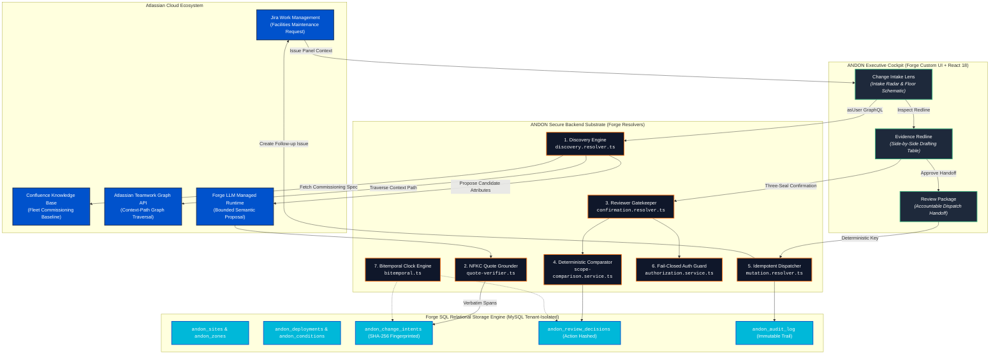

<div align="center">

# ⚡ ANDON
### Shadow-Change Radar for Robotized Workplaces

> *"You did not change the robot. You changed the world its approval assumed."*

[](https://developer.atlassian.com/platform/forge/)
[](https://developer.atlassian.com/cloud/jira/platform/)
[-8A2BE2?logo=anthropic&logoColor=white)](https://developer.atlassian.com/platform/forge/runtime-reference/forge-llm-api/)
[](https://developer.atlassian.com/platform/forge/runtime-reference/forge-sql-api/)
[-36B37E?logo=jest&logoColor=white)](file:///test/)
[](file:///docs/SECURITY.md)
[](LICENSE)

<br/>

[**The Problem**](#-the-problem-worth-solving) •
[**Core Architecture**](#-architecture--data-flow) •
[**The 3-Step Safety Workflow**](#-the-three-step-safety-workflow) •
[**Seven Deterministic Mechanisms**](#-seven-deterministic-safety-mechanisms) •
[**Bitemporal State Model**](#-bitemporal-state-model) •
[**Getting Started**](#-getting-started) •
[**Verification Suite**](#-automated-verification-suite)

</div>

---

## 🧭 The Problem Worth Solving

In automated industrial facilities, distribution centers, and advanced manufacturing plants, routine facility work frequently alters ambient physical conditions:

* **Surface Maintenance:** Re-coating, deep degreasing, polish buffing, sealant application.
* **Lighting Infrastructure:** Upgrading high-bay sodium lamps to smart scheduled LED luminaires.
* **Environmental Controls:** Thermal setpoints, directional HVAC airflow baffles, particulate filters.

### The Intake Gap

```
┌──────────────────────────────────────┐       ┌──────────────────────────────────────┐
│       Jira Facilities Ticket         │       │     Confluence Engineering Record    │
│                                      │       │                                      │
│  "Apply high-gloss clear finish to   │   ❌  │  "Autonomous mobile robot route      │
│   Aisle 7 next Saturday morning"     │ SILO  │   baseline assumed matte epoxy floor │
│                                      │       │   finish with diffuse reflectance."  │
└──────────────────────────────────────┘       └──────────────────────────────────────┘
                  │                                               │
                  └───────────────────────┬───────────────────────┘
                                          ▼
                      ╔═══════════════════════════════╗
                      ║    ANDON Shadow-Change Radar  ║
                      ║  Semantic Graph Traversal +   ║
                      ║  Deterministic Coverage Check ║
                      ╚═══════════════════════════════╝
```

When building maintenance logs a request in **Jira**, the facilities team has no visibility into the robotics commissioning baselines locked inside **Confluence**. Conversely, the robotics engineering team has no advance warning of physical space alterations until work is already completed.

* **ANSI/A3 R15.08 Part 3 (2026):** Formally codifies Management of Change (MoC) for industrial mobile robot applications and their physical operating environments.
* **OSHA Robot Systems Guidance:** Mandates that comprehensive risk assessments include ambient facility modifications—explicitly citing overhead lighting and floor maintenance.

**ANDON bridges this operational divide.** It traverses the organizational context graph to connect proposed physical work to documented operating assumptions, computes prospective coverage gaps deterministically, and arms authorized engineers with an accountable review ceremony before changes take effect.

---

## 🏛 Architecture & Data Flow

ANDON operates on a **zero-egress, tenant-isolated runtime** running entirely within the Atlassian Forge Cloud security boundary.



---

## 🎯 The Three-Step Safety Workflow

```
[ Step 1: Change Lens ] ──────> [ Step 2: Evidence Redline ] ──────> [ Step 3: Review Package ]
  Intake radar scans              Side-by-side drafting diff           Deterministic gap check
  unlinked maintenance            with verbatim text quotes            with approved follow-up
  tickets via Teamwork Graph      and 3-seal human confirmation        task creation in Jira
```

### 1. Change Intake Lens (The Radar)
* **Embedded in Jira:** Activates directly inside the Jira Issue Panel for facilities work orders.
* **Context Discovery:** Identifies the target zone, site, and effective dates. Queries the **Teamwork Graph** to find linked robotics commissioning documents without requiring prior manual issue linking.
* **Candidate Proposals:** Discovers candidate operating relationships. Every extracted relationship is strictly marked as `Candidate`—preventing automated mutations.

### 2. Evidence Redline (The Side-by-Side Review)
* **Drafting Diff:** Presents the exact verbatim quote from the Jira work order alongside the exact versioned operating condition clause from Confluence.
* **Full Context Provenance:** Displays the live Teamwork Graph path: `Site Registry` ➔ `Zone` ➔ `Robot Deployment` ➔ `Commissioning Baseline Document` ➔ `Responsible Owner`.
* **Human Confirmation Ceremony:** An authorized reviewer must review and verify:
  1. *Location Identity:* The physical zone matches the robot operating perimeter.
  2. *Deployment Match:* The specific robot or fleet profile is correctly identified.
  3. *Changed Attribute:* The physical condition parameter is accurately classified.
* **Dismissal with Reason:** Includes a prominent *"Not Related"* action that stores an immutable audit reason and records source versions.

### 3. Review Package (The Accountable Handoff)
* **Deterministic Coverage Finding:** An algorithmic set-membership check evaluates whether the proposed condition is covered by the baseline evidence:
  > *"The selected baseline does not establish coverage of the planned condition."*
* **Zero Fabricated Claims:** Never manufactures sensationalized physical assertions or speculative hazard predictions.
* **Follow-up Jira Task Dispatch:** Generates a pre-filled, reviewer-approved engineering task in the designated robotics project with stable idempotency keys.

---

## 🛡️ Seven Deterministic Safety Mechanisms

| # | Mechanism | Implementation | Guarantee |
|---|---|---|---|
| **M1** | **Declarative Condition Registry** | `condition-registry.ts` | Allows adding new physical condition families (surface finish, lighting, temperature) dynamically without code changes. |
| **M2** | **Bounded Single-Loop Extraction** | `llm.service.ts` | LLM is restricted to candidate attribute proposal. Zero tool execution, zero mutation access, zero prompt injection vulnerability. |
| **M3** | **NFKC Substring Quote Grounding** | `quote-verifier.ts` | Every extracted text quote must be an exact NFKC-normalized substring of the live source. Hallucinated or paraphrased text fails closed. |
| **M4** | **Deterministic Comparator** | `scope-comparison.service.ts` | Set-membership algorithm determines coverage (`GAP`, `COVERED`, `ALTERNATIVE_PATH`). Math and logic, never an LLM guess. |
| **M5** | **Registry-Only Identity Resolution** | `repository.ts` | Zones and deployments resolve strictly against registered database records. Unmapped or ambiguous locations fail closed to `UNKNOWN`. |
| **M6** | **Compound Idempotency Hashing** | `idempotency.service.ts` | SHA-256 keys (`changeIntentId::deploymentId`) prevent duplicate follow-up Jira ticket creation on webhook retries or double clicks. |
| **M7** | **Bitemporal Evaluation & Staleness** | `staleness.service.ts` | Distinguishes System Time from Business Time. Content fingerprinting immediately detects if Jira or Confluence sources changed post-review. |

---

## ⏱ Bitemporal State Model

ANDON separates two distinct timelines:
1. **System Time (`recorded_at`):** When the system discovered or processed the records.
2. **Business Time (`effective_from`):** When the physical work is scheduled to execute on the facility floor.

```
       System Time: Ticket Logged (Oct 12)           Review Completed (Oct 13)
──────────────●───────────────────────────────────────────────●────────────────────────────►
                                                                   ▲
                                                       Fingerprint verified clean
                                                                   │
                                                                   ▼
───────────────────────────────────────────────────────────────────●────────────────────────►
       Business Time: Prospective Period              Physical Floor Work Starts (Oct 18)
```

### Formal State Transition Table

| Formal State | Description | Invariant & Transition Rules |
|---|---|---|
| `CANDIDATE` | Discovered by LLM from text analysis. | Read-only. Requires human verification before any evaluation. |
| `CONFIRMED` | Verified by an authorized engineer. | Unlocks deterministic comparison against the commissioning baseline. |
| `PROSPECTIVE_GAP` | Planned condition is outside baseline scope. | Authorizes creation of a re-validation follow-up Jira task. |
| `COVERED` | Planned condition is within declared scope. | Confirmed safe under existing documented engineering assumptions. |
| `UNKNOWN` | Incomplete data, empty scope, or ambiguous zone. | Fails closed safely. Never assumes safety in the absence of evidence. |
| `DISMISSED` | Reviewer explicitly rejected proposal. | Dismissal reason and source document versions are immutably archived. |
| `STALE` | Source Confluence or Jira content changed. | Confirmation lock is engaged; re-evaluation is strictly required. |
| `FOLLOW_UP_CREATED` | Approved Jira task dispatched. | Idempotency lock prevents duplicate ticket creation on replays. |

---

## 🚀 Getting Started

### Prerequisites

* **Node.js:** `^22.23.4`, `^24.22.1`, or `>=26.12.1` (Active LTS)
* **Atlassian Forge CLI:** `npm install -g @forge/cli` (v15+)
* **Atlassian Cloud Site:** Jira Cloud + Confluence Cloud with Administrator access.

### 1. Clone & Install

```bash
git clone https://github.com/your-org/andon-shadow-radar.git
cd andon-shadow-radar

# Install root backend dependencies
npm install

# Install and build frontend React Custom UI bundle
cd static/frontend
npm install
npm run build
cd ../..
```

### 2. Authenticate & Deploy

```bash
# Log in to your Atlassian developer account
forge login

# Deploy app to development environment
forge deploy

# Install into Jira
forge install -p Jira -s your-site.atlassian.net -e development --confirm-scopes

# Install into Confluence
forge install -p Confluence -s your-site.atlassian.net -e development --confirm-scopes
```

### 3. Configure Site Registry

1. Open any Jira issue in your project.
2. Open the **ANDON** Issue Panel.
3. Navigate to **Administration** (⚙️):
   * Set your **Confluence Site Registry Page ID** (the root Confluence page indexing your zones and robot fleets).
   * Set your **Default Follow-Up Jira Project Key** (e.g. `ROBOT` or `ENG`).
   * Choose your **Reviewer Policy Mode** (`configured_list` or `owner_only`).
4. Click **Save Configuration**.

---

## 🧪 Automated Verification Suite

ANDON enforces continuous integrity gates with 100% test coverage across 24 test suites:

```bash
# Run the complete CI verification pipeline:
npm run ci
```

### Verification Pipeline Components

```
┌───────────────────────────────┬────────────────────────────────────────────┬───────────┐
│ Verification Gate             │ Command                                    │ Status    │
├───────────────────────────────┼────────────────────────────────────────────┼───────────┤
│ Node LTS Compatibility Check  │ node scripts/check-node.js                 │ ✓ PASS    │
│ TypeScript Typecheck & Lint   │ npm run lint                               │ ✓ PASS    │
│ Full Unit & Integration Suite │ npm test (24 suites, 148 tests)            │ ✓ 100%    │
│ Anti-Simulation Scanner       │ node scripts/no-fakes.js                   │ ✓ CLEAN   │
│ Credential & Secret Scanner   │ node scripts/secret-scan.js                │ ✓ CLEAN   │
│ Split Evaluation Harness      │ npm run eval:run (16/16 test split)        │ ✓ 100%    │
│ Invariant Property Checks     │ npm run verify:mechanisms (14/14 checks)   │ ✓ 100%    │
└───────────────────────────────┴────────────────────────────────────────────┴───────────┘
```

---

## 🔒 Security & Privacy Posture

* **Zero-Egress Boundary:** ANDON makes zero outbound HTTP requests to external third-party servers. All computation runs inside Atlassian Forge.
* **Fail-Closed Authorization:** Every user-facing resolver derives the actor's identity directly from the authenticated Forge context (`context.accountId`). Object-level authorization prevents unauthorized confirmations.
* **Untrusted Content as Data:** Jira ticket summaries, descriptions, and comments are treated strictly as untrusted evidence data—never as agent instructions.
* **Immutable Audit Trail:** Reviewer confirmations, dismissals, and follow-up actions are persisted in Forge SQL with content fingerprints and timestamps.

---

## 📄 License & Standards

* **License:** Apache License 2.0. See [LICENSE](LICENSE) for details.
* **Industrial Safety Standards Alignment:**
  * **ANSI/A3 R15.08 Part 3 (2026):** *Industrial Mobile Robots — Management of Change*.
  * **OSHA Directive CPL 02-01-066:** *Safeguarding of Industrial Mobile and Fixed Robot Systems*.

---

<div align="center">

**Built for industrial safety with Atlassian Forge & Teamwork Graph**  
*Preventing shadow changes before physical execution begins.*

</div>
