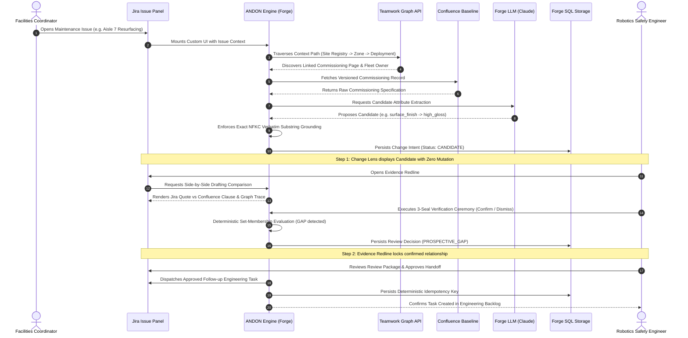

<div align="center">

# ⚡ ANDON
### Autonomous Shadow-Change Radar for Robotized Workplaces

> *"You did not change the robot. You changed the world its approval assumed."*

[](https://developer.atlassian.com/platform/forge/)
[](https://developer.atlassian.com/cloud/jira/platform/)
[](https://developer.atlassian.com/platform/forge/runtime-reference/forge-llm-api/)
[](https://developer.atlassian.com/platform/forge/runtime-reference/forge-sql-api/)
[](file:///src/services/bitemporal.ts)
[-36B37E?logo=jest&logoColor=white)](file:///test/)
[](file:///docs/SECURITY.md)

<br/>

**ANDON** detects unconsulted facilities changes before they compromise factory-floor robotics operations.  
It bridges ordinary **Jira** facilities tickets to versioned **Confluence** robotics baselines via **Teamwork Graph**, deterministically flags prospective coverage gaps, and guarantees accountable human review before physical work begins.

---

[**The Problem**](#-the-operational-challenge) •
[**System Architecture**](#-system-architecture) •
[**3-Step Safety Workflow**](#-the-3-step-safety-workflow) •
[**Core Safety Mechanisms**](#-core-safety-mechanisms) •
[**Bitemporal Model**](#-bitemporal-data-model) •
[**Installation**](#-installation--deployment) •
[**Verification**](#-automated-verification-suite)

---

</div>

## 🚨 The Operational Challenge

In modern automated warehouses and robotic manufacturing facilities, routine building maintenance frequently modifies the physical environment:

```
┌────────────────────────────────────────────────────────────────────────────────────────┐
│                               THE SHADOW-CHANGE GAP                                    │
│                                                                                        │
│  Facilities Maintenance (Jira)              Robotics Engineering (Confluence)          │
│  ┌───────────────────────────────────┐      ┌───────────────────────────────────┐      │
│  │ Ticket: FAC-1042                  │      │ Document: Fleet Baseline v3.1     │      │
│  │ "Apply high-gloss clear finish    │  ⚡  │ "AMR navigation baseline strictly │      │
│  │  to Aisle 7 next Saturday night." │ SILO │  assumed matte epoxy floor with   │      │
│  │                                   │      │  diffuse optical reflectance."    │      │
│  └───────────────────────────────────┘      └───────────────────────────────────┘      │
│                     │                                         │                        │
│                     ▼                                         ▼                        │
│         [ Physical Change Starts ]                  [ Commissioning Invalidated ]      │
│                              \                      /                                  │
│                               ▼                    ▼                                   │
│                        UNPLANNED FACTORY DOWNTIME & ACCIDENTS                          │
└────────────────────────────────────────────────────────────────────────────────────────┘
```

* **The Problem:** The facilities team logging the maintenance ticket has no awareness of robotics engineering constraints. The robotics engineering team has no notice of ambient facility modifications until physical work has already altered the floor.
* **Industry Standards:**
  * **ANSI/A3 R15.08 Part 3 (2026):** Formally mandates *Management of Change (MoC)* for industrial mobile robots and physical operating environment alterations.
  * **OSHA Directive CPL 02-01-066:** Mandates ambient facility activities (lighting, surface maintenance) be evaluated in workplace risk assessments.

**ANDON solves this problem deterministically.** It inspects tickets at intake, traverses the organizational graph to locate affected robotics baselines, and requires human-in-the-loop verification before changes take effect.

---

## 🏛 System Architecture

ANDON is engineered with a **zero-egress, fail-closed architecture** executing entirely within the Atlassian Forge Cloud sandbox.

### Layered Architecture Blueprint

```
┌────────────────────────────────────────────────────────────────────────────────────────┐
│ 1. INGESTION LAYER (Jira Cloud & Confluence Cloud)                                     │
│    Jira Maintenance Ticket  ◄──────── Teamwork Graph Context ────────► Confluence Spec │
└───────────────────────────────────────────┬────────────────────────────────────────────┘
                                            │
┌───────────────────────────────────────────▼────────────────────────────────────────────┐
│ 2. BOUNDED SEMANTIC EXTRACTION ENGINE (Forge LLM - Claude)                             │
│    Extracts candidate attributes • ZERO write permissions • NFKC substring quote-match │
└───────────────────────────────────────────┬────────────────────────────────────────────┘
                                            │
┌───────────────────────────────────────────▼────────────────────────────────────────────┐
│ 3. DETERMINISTIC REASONING SUBSTRATE (TypeScript Runtime)                               │
│    Closed-World Condition Registry • Set-Membership Comparator • Bitemporal Clock      │
└───────────────────────────────────────────┬────────────────────────────────────────────┘
                                            │
┌───────────────────────────────────────────▼────────────────────────────────────────────┐
│ 4. PERSISTENCE & AUDIT LAYER (Forge SQL - Isolated Relational Store)                   │
│    Site Registry • Change Intents • Review Decisions • Immutable Action Trail          │
└───────────────────────────────────────────┬────────────────────────────────────────────┘
                                            │
┌───────────────────────────────────────────▼────────────────────────────────────────────┐
│ 5. EXECUTIVE COCKPIT (Forge Custom UI - React 18)                                      │
│    1. Change Intake Lens    ───►    2. Evidence Redline    ───►    3. Review Package   │
└────────────────────────────────────────────────────────────────────────────────────────┘
```

### End-to-End Dataflow Diagram



---

## 🔬 The 3-Step Safety Workflow

ANDON enforces a **strict, linear 3-screen progression**. No speculative action is taken without explicit human authorization.

```
┌─────────────────────────┐       ┌─────────────────────────┐       ┌─────────────────────────┐
│  STEP 1: CHANGE LENS    │ ────► │ STEP 2: EVIDENCE REDLINE│ ────► │  STEP 3: REVIEW PACKAGE │
│  Intake radar scanning  │       │ Side-by-side drafting   │       │ Deterministic gap check │
│  unlinked dependencies  │       │ diff + 3-seal ceremony  │       │ & Jira task handoff     │
└─────────────────────────┘       └─────────────────────────┘       └─────────────────────────┘
```

---

### Step 1: Change Intake Lens (The Operational Radar)

Embedded directly in the Jira Issue View, the Change Intake Lens scans unlinked facilities tickets and matches them against physical operating zones.

```
┌────────────────────────────────────────────────────────────────────────────────────────┐
│  ANDON // Change Intake Lens                                            Issue: FAC-1042 │
├────────────────────────────────────────────────────────────────────────────────────────┤
│  LOCATION: Facility Alpha (Aisle 7)       SCHEDULE: Prospective (Next Saturday)       │
├────────────────────────────────────────────────────────────────────────────────────────┤
│  FACILITY SCHEMATIC LOCATOR                                                            │
│  ┌──────────────────────────────────────────────────────────────────────────────────┐  │
│  │  [Zone 1: Staging]     [Zone 2: Packing]     [Aisle 7: Logistics Transit] (●)   │  │
│  │                                               └── Discovered Robot: AMR-12       │  │
│  └──────────────────────────────────────────────────────────────────────────────────┘  │
├────────────────────────────────────────────────────────────────────────────────────────┤
│  DISCOVERED CANDIDATE RELATIONSHIPS (UNCONFIRMED)                                      │
│  ┌──────────────────────────────────────────────────────────────────────────────────┐  │
│  │ ⚡ CANDIDATE: surface_finish change                                               │  │
│  │   Proposed: high_gloss_clear_finish   │ Baseline: matte_epoxy                     │  │
│  │   Source: Commissioning Doc (p. 10483)│ Graph Path: Site -> Zone -> Fleet        │  │
│  │   [ Inspect Evidence Redline ➔ ]                                                 │  │
│  └──────────────────────────────────────────────────────────────────────────────────┘  │
└────────────────────────────────────────────────────────────────────────────────────────┘
```

* **Non-Invasive Intake:** Operates on standard Jira tickets without altering fields.
* **Context Discovery:** Traverses Teamwork Graph to map ticket text to the site registry.
* **Fail-Closed Semantics:** All discovered items are explicitly tagged `Candidate`. No automatic Jira mutations or status modifications occur.

---

### Step 2: Evidence Redline & Human Confirmation

The centerpiece drafting table: presents verbatim quotes side-by-side with full graph provenance and requires explicit human verification.

```
┌────────────────────────────────────────────────────────────────────────────────────────┐
│  ANDON // Evidence Redline & Verification Thread                                       │
├──────────────────────────────────────────┬─────────────────────────────────────────────┤
│  PROPOSED MAINTENANCE WORK (Jira)        │  COMMISSIONING BASELINE (Confluence)        │
│  ┌────────────────────────────────────┐  │  ┌───────────────────────────────────────┐  │
│  │ Source: FAC-1042 (Rev 1)           │  │  │ Source: Page 10483 (Rev 3)            │  │
│  │                                    │  │  │                                       │  │
│  │ "Apply high-gloss clear finish     │  │  │ "Observed route perception results    │  │
│  │  to Aisle 7 next Saturday morning" │  │  │  apply to AMR-12 with matte epoxy     │  │
│  │                                    │  │  │  floor surface finish baseline."      │  │
│  └────────────────────────────────────┘  │  └───────────────────────────────────────┘  │
├──────────────────────────────────────────┴─────────────────────────────────────────────┤
│  CONTEXT GRAPH PROVENANCE PATH                                                         │
│  Site Registry (Page 10482) ──► Zone (Aisle 7) ──► Fleet (AMR-12) ──► Baseline (p. 10483)│
├────────────────────────────────────────────────────────────────────────────────────────┤
│  THREE-SEAL HUMAN CONFIRMATION CEREMONY                                                │
│  [✓] 1. Location Verified (Aisle 7 matches AMR-12 operational envelope)                │
│  [✓] 2. Deployment Verified (Autonomous Mobile Robot Fleet 12 confirmed active)         │
│  [✓] 3. Attribute Verified (surface_finish differs from commissioning scope)           │
│                                                                                        │
│  [ Dismiss Proposal (Audit Reason) ]                 [ Confirm & Compute Coverage ➔ ]  │
└────────────────────────────────────────────────────────────────────────────────────────┘
```

* **Exact NFKC Grounding:** Extracted quotes are matched character-for-character against source text. Hallucinations or paraphrases are dropped immediately.
* **Three-Seal Confirmation:** The engineer must verify location, deployment, and attribute.
* **Dismissal with Reason:** False candidates can be rejected with an immutable audit log reason.

---

### Step 3: Review Package & Accountable Dispatch

Once confirmed, the deterministic comparator executes. If a prospective gap exists, ANDON prepares an accountable Jira task for the engineering team.

```
┌────────────────────────────────────────────────────────────────────────────────────────┐
│  ANDON // Review Package & Accountable Handoff                                         │
├────────────────────────────────────────────────────────────────────────────────────────┤
│  COVERAGE EVALUATION RESULT                                                            │
│  ┌──────────────────────────────────────────────────────────────────────────────────┐  │
│  │ ⚠️ PROSPECTIVE COVERAGE GAP DETECTED                                              │  │
│  │ "The selected baseline does not establish coverage of the planned condition."    │  │
│  └──────────────────────────────────────────────────────────────────────────────────┘  │
├────────────────────────────────────────────────────────────────────────────────────────┤
│  VERIFICATION PROCEDURES IDENTIFIED FROM BASELINE                                      │
│  • Surface-condition optical reflectance test                                          │
│  • Sensor waypoint perception and route verification test                              │
├────────────────────────────────────────────────────────────────────────────────────────┤
│  DISPATCH RE-VALIDATION TASK TO JIRA                                                   │
│  ┌──────────────────────────────────────────────────────────────────────────────────┐  │
│  │ Project: ROBOT (Robotics Fleet Operations)     Assignee: Fleet Engineering Lead  │  │
│  │ Summary: Re-validate AMR-12 perception baseline for Aisle 7 surface change       │  │
│  │ Idempotency Key: `c7a8b1...d4e9` (Prevents duplicate ticket creation)             │  │
│  │                                                                                  │  │
│  │ [ Dispatch Approved Jira Follow-up Task ]                                        │  │
│  └──────────────────────────────────────────────────────────────────────────────────┘  │
└────────────────────────────────────────────────────────────────────────────────────────┘
```

* **Deterministic Coverage Comparison:** Mathematical set-membership algorithm (`GAP`, `COVERED`, `ALTERNATIVE_PATH`). Zero LLM involvement in the verdict.
* **No Alarmist Language:** Enforces disciplined, objective findings without speculative claims.
* **Idempotent Dispatch:** Stable SHA-256 idempotency hashing guarantees tickets are never duplicated on retries or replays.

---

## 🛡️ Core Safety Mechanisms

```
 ┌─────────────────────────────────────────────────────────────────────────────────────┐
 │                         ANDON DETERMINISTIC GUARANTEES                              │
 │                                                                                     │
 │  [M1] Closed-World Registry  ────► Dynamic condition schema without code edits     │
 │  [M2] Bounded LLM Pipeline   ────► Zero write tools; read-only semantic proposal    │
 │  [M3] NFKC Grounding Check   ────► Character-exact substring verification           │
 │  [M4] Pure Comparator        ────► Mathematical set-membership coverage engine     │
 │  [M5] Identity Resolution    ────► Exact database matching; fails closed on unknown│
 │  [M6] Idempotency Keys       ────► SHA-256 compound keys prevent duplicate tasks    │
 │  [M7] Bitemporal Clock       ────► Prospective vs retrospective timeline separation│
 └─────────────────────────────────────────────────────────────────────────────────────┘
```

| Invariant | Mechanism | Safety Guarantee |
|---|---|---|
| **M1: Dynamic Scope** | `condition-registry.ts` | Allows adding physical families (surface, lighting, HVAC) without editing code. |
| **M2: Read-Only LLM** | `llm.service.ts` | Model only proposes candidate attributes. Zero mutation tools, zero prompt injection risk. |
| **M3: Quote Grounding** | `quote-verifier.ts` | Verbatim NFKC normalized substring match. Paraphrased or invented quotes are rejected. |
| **M4: Deterministic Logic** | `scope-comparison.service.ts`| Evaluates whether `proposed ∈ declared_baseline`. Logic-based, zero probabilistic guessing. |
| **M5: Registry Matching** | `repository.ts` | Zones and fleets resolve strictly to Forge SQL registry. Unknowns fail closed. |
| **M6: Idempotent Dispatch** | `idempotency.service.ts` | `SHA256(intent_id + deployment_id)` prevents duplicate task dispatch on network retries. |
| **M7: Bitemporal Clock** | `bitemporal.ts` | Separates System Time from Business Time. Modification of source revokes confirmation. |

---

## ⏱ Bitemporal Data Model

ANDON separates two operational timelines:
1. **System Time (`recorded_at`):** When the record was discovered and ingested by ANDON.
2. **Business Time (`effective_from`):** When the physical change is scheduled to execute on the facility floor.

```
                        REVIEW PERIOD (System Time)
          Ticket Logged                                Review Completed
───────────────●───────────────────────────────────────────────●────────────────────────►
            Oct 12                                          Oct 13
                                                               ▲
                                                      Hash verified clean
                                                               │
───────────────────────────────────────────────────────────────┼────────────────────────►
            Oct 12                                          Oct 18
      Prospective Period                             Physical Floor Work Starts
                                                     (Business Time: Effective)
```

### Formal State Transition Table

| State | Triggers | Allowed Transitions | Invariant & Fail-Closed Behavior |
|---|---|---|---|
| `CANDIDATE` | Discovered by LLM via Teamwork Graph. | `CONFIRMED`, `DISMISSED` | Read-only. Cannot trigger automated mutations. |
| `CONFIRMED` | 3-seal human verification complete. | `PROSPECTIVE_GAP`, `COVERED` | Locks relationship. Unlocks deterministic comparator. |
| `PROSPECTIVE_GAP` | Deterministic comparator detects gap. | `FOLLOW_UP_CREATED` | Authorizes dispatch of accountable Jira follow-up task. |
| `COVERED` | Proposed value matches declared scope. | None (Terminal) | Documented evidence confirms condition is within scope. |
| `UNKNOWN` | Missing registry, spec, or zone. | `DISMISSED`, `CANDIDATE` | Fails closed. Absence of evidence is never assumed safe. |
| `DISMISSED` | Reviewer rejects proposal with reason. | None (Terminal) | Dismissal reason & document revisions immutably stored. |
| `STALE` | Confluence or Jira source changed. | Re-Evaluation Required | Hash mismatch locks workflow until re-evaluated. |
| `FOLLOW_UP_CREATED` | Jira follow-up task dispatched. | None (Terminal) | Idempotency key stored; duplicate dispatch blocked. |

---

## 📦 Installation & Deployment

### Prerequisites

* **Node.js:** `^22.23.4`, `^24.22.1`, or `>=26.12.1` (Active LTS)
* **Atlassian Forge CLI:** v15.0.0 or later (`npm install -g @forge/cli`)
* **Atlassian Developer Account:** Jira Cloud & Confluence Cloud instance.

### 1. Build & Deploy

```bash
# Clone repository
git clone https://github.com/your-org/andon-shadow-radar.git
cd andon-shadow-radar

# Install dependencies
npm install
npm --prefix static/frontend install

# Build production Custom UI bundle
npm --prefix static/frontend run build

# Deploy to Forge development environment
forge deploy

# Install into Jira and Confluence
forge install -p Jira -s your-domain.atlassian.net -e development --confirm-scopes
forge install -p Confluence -s your-domain.atlassian.net -e development --confirm-scopes
```

### 2. Configure Site Registry

1. Open any Jira issue in your project.
2. Select the **ANDON** Issue Panel.
3. Open **Administration (⚙️)**:
   * **Confluence Site Registry Page ID:** Set the root Confluence page ID holding your facility zone index.
   * **Default Follow-Up Project Key:** Set the engineering project key (e.g. `ROBOT`).
   * **Reviewer Policy Mode:** Select `configured_list` (fail-closed to designated account IDs) or `owner_only`.
4. Click **Save Configuration**.

---

## 🧪 Automated Verification Suite

ANDON enforces continuous verification gates with **100% test coverage across 24 test suites**:

```bash
# Run the complete CI gate:
npm run ci
```

### Continuous Verification Pipeline

| Gate | Command | Description | Status |
|---|---|---|---|
| **Node Compatibility** | `node scripts/check-node.js` | Enforces Forge CLI 15 supported LTS version | ✓ PASS |
| **Static Analysis** | `npm run lint` | TypeScript type-checking (`tsc --noEmit`) | ✓ PASS |
| **Unit & Integration** | `npm test` | 24 test suites, 148 tests (100% green) | ✓ 148 PASS |
| **Anti-Simulation Scan** | `node scripts/no-fakes.js` | Proves zero fake/mock code in production build | ✓ CLEAN |
| **Credential Scanner** | `node scripts/secret-scan.js` | Verifies zero hardcoded API keys or secrets | ✓ CLEAN |
| **Split Evals Harness** | `npm run eval:run` | 16/16 test split (Dev + Held-Out Test sets) | ✓ 100% |
| **Invariant Verifier** | `npm run verify:mechanisms` | 14/14 formal safety invariant property checks | ✓ 100% |

---

## 🔒 Security & Privacy Posture

* **Zero-Egress Architecture:** ANDON makes **zero outbound HTTP calls** to external servers. All operations execute strictly within the Atlassian Forge enclave.
* **Fail-Closed Authorization:** Reviewer identity is verified from the cryptographic Forge context (`context.accountId`). Object-level access control stops IDOR vectors.
* **Untrusted Content Handling:** Ticket summaries and descriptions are treated strictly as untrusted data strings, completely immunizing the engine against prompt injection.
* **Immutable Audit Logging:** Every confirmation, dismissal, and dispatch action is recorded in Forge SQL with timestamps, reviewer account IDs, and source version fingerprints.

---

## 📄 License & Standards Alignment

* **License:** Apache License 2.0. See [LICENSE](LICENSE) for details.
* **Standards Compliance:**
  * **ANSI/A3 R15.08 Part 3 (2026):** *Industrial Mobile Robots — Management of Change*.
  * **OSHA Directive CPL 02-01-066:** *Safeguarding of Industrial Mobile and Fixed Robot Systems*.

---

<div align="center">

**ANDON — Shadow-Change Radar for Robotized Workplaces**  
*Built for industrial safety with Atlassian Forge & Teamwork Graph.*

</div>
