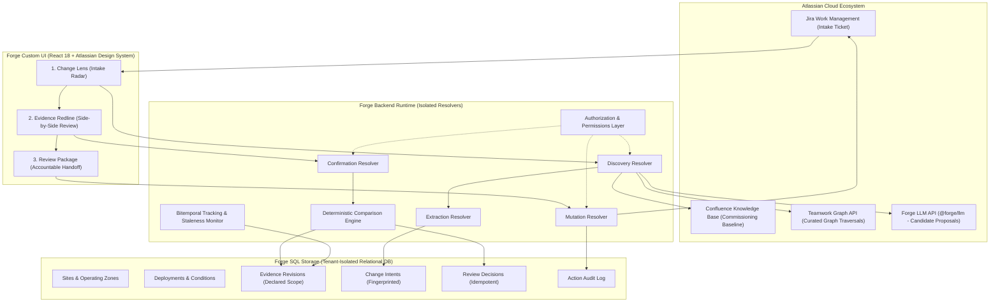

# ANDON: Shadow-Change Radar for Robotized Workplaces

> **Codegeist 2026 Submission**  
> **Category:** Apps for Specialized Industries  
> **Primary Bonus Target:** Teamwork Graph Integration  
> **The Pitch:** *"You did not change the robot. You changed the world its approval assumed."*

---

## The Problem Worth Solving

In automated and robotized workplaces, building facilities work (e.g., floor resurfacing, lighting upgrades, sensor cleaning, HVAC maintenance) often directly alters physical operating parameters that mobile robots rely upon. 

- **OSHA Robot Systems Guidance:** Emphasizes that workplace risk assessments must include ambient facility activities even when not directly connected to the robot application, explicitly citing overhead light maintenance.
- **ANSI/A3 R15.08 Part 3 (2026):** Formally addresses management of change for industrial mobile robot applications and their physical operating environments.
- **The Intake Gap:** When a building maintenance ticket is filed in Jira (e.g., *"Apply high-gloss clear finish to Aisle 7 next Saturday"*), the facilities coordinator has no indication that the robot fleet commissioning baseline strictly assumed a *matte epoxy finish*.

ANDON connects ordinary Jira facilities requests to documented operating assumptions in Confluence via **Teamwork Graph**, makes the prospective coverage gap inspectable via an **Evidence Redline**, and lets an authorized reviewer dispatch accountable Jira follow-up work before physical work begins.

---

## Architecture Overview



---

## The Three-Screen Workflow

1. **Change Lens (Intake Radar):**
   - Opens on an ordinary facilities Jira ticket.
   - Shows the intake summary, target zone, and effective timing.
   - Displays candidate relationships proposed by Forge LLM analysis of linked Confluence pages discovered via Teamwork Graph.
   - Clearly flags proposals as `Candidate` — no automatic actions or assumptions of physical completion.

2. **Evidence Redline (Side-by-Side Inspection):**
   - Left panel: The exact quoted facilities maintenance request from Jira.
   - Right panel: The exact versioned operating condition clause from the Confluence commissioning baseline.
   - Center panel: Real Teamwork Graph provenance path (Site Registry → Zone → Commissioning Page → Owner).
   - Reviewer Confirmation Checklist: The qualified reviewer must explicitly check off location, deployment, changed attribute, and proposed values before any evaluation occurs.
   - Prominent **"Not Related"** button to dismiss false candidates with an immutable audit reason.

3. **Review Package (Accountable Handoff):**
   - Evaluates coverage with a pure deterministic algorithm:
     > *"The selected baseline does not establish coverage of the proposed high-gloss condition."*
   - Never manufactures alarmist verdicts: never asserts *"robot will fail"* or *"floor is unsafe"*.
   - Surfaces real verification procedures (e.g. Surface-condition review, sensor waypoint perception test) from the baseline test plan.
   - Identifies the responsible reviewer from live configuration or Confluence ownership data.
   - Creates a reviewer-approved Jira task in the designated engineering project with stable idempotency keys.

---

## State Model

ANDON implements the strict state transitions required for industrial change review:

| State | Definition |
|---|---|
| `Candidate` | The LLM proposes a relationship from text; no confirmed impact or automatic task creation. |
| `Confirmed relationship` | An authorized human confirms the deployment, location, and changed attribute match. |
| `Prospective coverage gap` | Planned condition is outside the declared baseline evidence scope. |
| `Current coverage review needed` | Work was confirmed completed; reassess physical evidence applicability. |
| `Unknown` | Specification, location identity, source access, or baseline evidence is missing. |
| `Dismissed with reason` | Reviewer explicitly rejects the proposal; reason is preserved with source versions. |
| `Supported within declared scope` | New reviewed evidence covers the changed condition. |
| `Stale assessment` | Underlying Confluence page or Jira ticket changed materially after review. |

---

## Prerequisites & Requirements

- **Node.js**: v18.0.0 or later (v20+ recommended)
- **Atlassian Forge CLI**: Install via npm:
  ```bash
  npm install -g @forge/cli
  ```
- **Atlassian Developer Account & Cloud Site**: Jira Cloud and Confluence Cloud instance with administrator permissions.

---

## Installation & Deployment

### 1. Register the Forge App
Navigate to the root directory `andon`:
```bash
cd andon
forge login
forge register
```

### 2. Install Dependencies & Build Frontend
```bash
# Install root dependencies
npm install

# Build the React Custom UI bundle
cd static/frontend
npm install
npm run build
cd ../..
```

### 3. Deploy to Atlassian Cloud
```bash
forge deploy -e development
```

### 4. Install into your Jira Cloud Site
```bash
forge install -e development
```
Select **Jira** and provide your Cloud site domain (e.g. `your-company.atlassian.net`).

---

## Production Configuration

ANDON contains **no hardcoded credentials, tenant URLs, project keys, or page IDs**.

On a fresh installation:
1. Open the ANDON panel on any Jira ticket in your project.
2. Click **⚙️ Settings** in the panel header.
3. Configure:
   - **Confluence Site Registry Page ID**: The numeric ID of the Confluence page that links to your facility zones and robot deployments.
   - **Default Follow-Up Jira Project Key**: The project key (e.g., `ROBOT` or `ENG`) where engineering review tasks should be dispatched.
4. Click **Save Configuration**.

---

## Synthetic Demonstration Scenario (Opt-In & Isolated)

For Codegeist judges and evaluators who wish to explore the documented **Aisle 7 floor-finish scenario**:
- A synthetic fixture is available in `demo/synthetic-scenario.json`.
- It can be imported into an isolated test site using:
  ```bash
  npx ts-node demo/import-synthetic-demo.ts
  ```
- Detailed evaluation instructions are in [`demo/README.md`](demo/README.md) and [`docs/JUDGE-GUIDE.md`](docs/JUDGE-GUIDE.md).
- **Production Isolation**: Synthetic records are never loaded in production resolvers or automatic migrations.

---

## Security, Privacy & Reliability

- **Content as Evidence, Not Instructions**: Ticket text is strictly parsed as data. Prompt injection attempts cannot execute tools or bypass human confirmation.
- **Human-in-the-Loop Mutation**: The LLM has zero mutation permissions. Only authenticated human engineers can create Jira issues or confirm relationships.
- **Permission Isolation**: Confluence content is fetched using current-user scoped authentication (`api.asUser()`). Users cannot view cached quotes or titles from documents they lack permission to access.
- **Idempotency & Retry Safety**: Follow-up Jira issue creation uses deterministic SHA-256 keys (`change_intent_id::deployment_id`). Ambiguous network timeouts transition to `UNCERTAIN` for reconciliation rather than duplicating tasks.
- **Bitemporal Tracking**: Distinguishes between physical change execution time (`effective_from`) and application discovery time (`recorded_at`).

---

## Known Platform Boundaries & Limitations

1. **Teamwork Graph Permissions**: Curated Teamwork Graph queries execute strictly under the authenticated user's context. Unattended background webhooks cannot traverse the graph without active user session credentials.
2. **Forge SQL Multi-Statement Transactions**: Forge SQL enforces single-statement execution. Multi-step workflows use explicit intermediate action states (`pending`, `confirmed`, `uncertain`) rather than nested SQL transaction locks.
3. **Display vs. Gate**: The MVP surfaces coverage gaps and creates approved follow-up tasks. Blocking Jira issue workflow transitions requires configuring a Forge Workflow Validator module in Jira project administration.

---

## Automated Test Verification

ANDON includes a comprehensive test suite across unit and integration levels:
```bash
# Run all 9 test suites (35 tests):
npm test
```
- `scope-comparison.test.ts`: Deterministic coverage comparison engine (gap, covered, unknown, alternative path).
- `content-fingerprint.test.ts`: Normalized SHA-256 hashing detecting text modifications.
- `source-span.test.ts`: Substring extraction, quote discovery, and contextual highlighting.
- `validation.test.ts`: Runtime schema validation and XSS sanitization.
- `staleness.test.ts`: Bitemporal version tracking detecting Confluence/Jira updates.
- `idempotency.test.ts`: Deterministic key generation and duplicate prevention.
- `discovery-flow.test.ts`: End-to-end discovery pipeline integration.
- `confirmation-flow.test.ts`: Reviewer confirmation and coverage gap calculation.
- `mutation-flow.test.ts`: Approved follow-up Jira creation and retry reconciliation.

