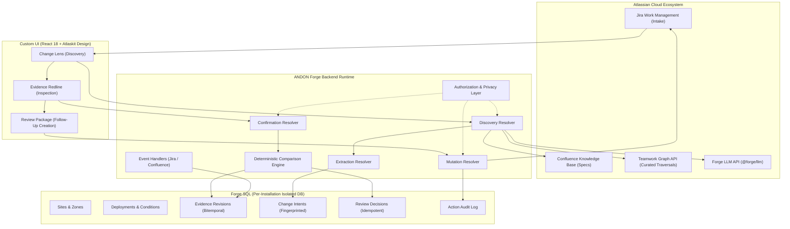

# ANDON: Technical Architecture & System Design

---

## 1. Architectural Distinction: The Two Graphs

ANDON maintains a strict technical separation between two distinct graphs:

1. **The Organizational Context Graph (Teamwork Graph):**
   - Answers: *"What documentation is linked to this facility, and who owns it?"*
   - Consumed via curated Teamwork Graph queries (`confluencePageLinkedConfluencePages`, `confluencePageOwners`).
   - Filtered by current-user permissions.
   - Never conflated with physical engineering causality.

2. **The App-Local Evidence Graph (Forge SQL):**
   - Answers: *"Which recorded evidence revision formally establishes coverage of which operating condition?"*
   - Stores version-bound scope records (`surface_finish = matte_epoxy`), physical zones, and review decisions.
   - Evaluated using deterministic set logic, not semantic guesswork.

---

## 2. Bitemporal Time Model

ANDON distinguishes between:
- **Business Time (`effective_from` / `effective_date`):** When the physical floor finish is scheduled to be applied.
- **System Time (`recorded_at` / `created_at`):** When ANDON discovered or evaluated the change.

A backdated maintenance ticket opens a historical lookback window over recorded robot runs rather than pretending a newly arriving ticket represents a newly occurring physical event.

---

## 3. Security, Privacy & Disclosure Boundaries

- **Treat Content as Evidence, Never Instructions:** The LLM extraction pipeline operates with strict system instructions and has **zero mutation tools**. Prompt injection attempts embedded in tickets cannot trigger state mutations.
- **Human-in-the-Loop Mutation:** Jira follow-ups can only be approved and created by authenticated, authorized engineers via explicit user action.
- **Source Access Verification:** When rendering redline views or review packages, ANDON verifies caller access to the referenced Confluence pages, preventing authorization leaks.
- **Protected Pointers:** Follow-up Jira issues contain structured scope references rather than sensitive document excerpts copied into broader visibility projects.

---

## 4. Idempotency & Retry Safety

- **Change Intents:** Identified by SHA-256 fingerprint of ticket content combined with proposed attribute.
- **Follow-Up Creation:** Guarded by a deterministic idempotency key (`change_intent_id::deployment_id`). If an external API response is lost in transit, the action state transitions to `UNCERTAIN` for automated reconciliation rather than risking duplicate task creation.

